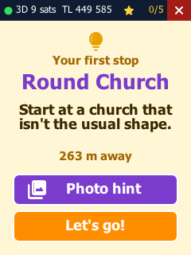
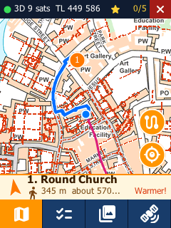
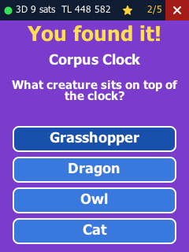
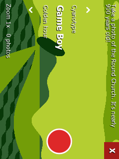
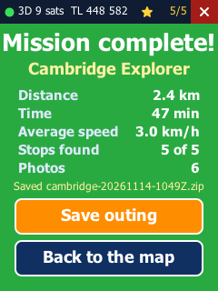

# GISmo

A GPS treasure hunt for kids, for the Trimble Juno SB handheld. Follow the arrow from stop to stop, answer questions, take photos, and come home with a map of where you went.

Grown-ups plan the missions on a PC with the [mission planner](https://gadgetoid.github.io/gismo/), and look back at the walk afterwards with the [outing viewer](https://gadgetoid.github.io/gismo/viewer.html).

    

## Getting started

1. From the [latest release](https://github.com/Gadgetoid/gismo/releases/latest), copy `GISmo-...-junosb.cab` to the Juno and tap it to install.
2. Copy the `GISmo` folder from `GISmo-...-card.zip` to the Juno's storage card.
3. Start GISmo outside, choose a mission, and follow the arrow.
4. Afterwards, open the zip from the card's `Outings` folder in the [outing viewer](https://gadgetoid.github.io/gismo/viewer.html).

The release comes with a mission and map for central Cambridge. To make your own, see [Mission planner](docs/mission-planner.md) and [Maps](docs/maps.md).

## More

- [Using GISmo](docs/using-gismo.md): the pages, buttons and camera.
- [Mission planner](docs/mission-planner.md), [Outing viewer](docs/outing-viewer.md), [Maps](docs/maps.md), [On the card](docs/card.md).
- [DEVELOPERS.md](DEVELOPERS.md): building and how it works.

MIT licensed. Maps contain Ordnance Survey and OpenStreetMap data; see [THIRD-PARTY.md](THIRD-PARTY.md).
