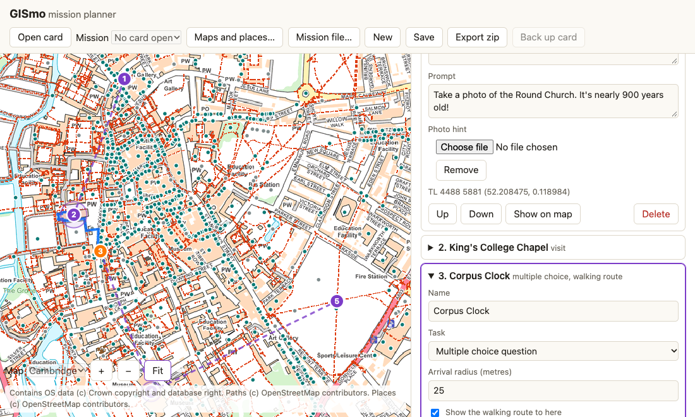

# Mission planner



The planner is a web page for making missions on a PC. Use it [online](https://gadgetoid.github.io/gismo/), where it opens with a map of central Cambridge, or from `Planner/index.html` on the card.

## Opening a card

In Chrome or Edge, **Open card** picks the storage card (or its `GISmo` folder). The planner loads its maps, places and walking routes, and lists its missions; **Save** writes the mission and any photo hints straight back to the card.

In other browsers, add maps with **Maps and places…** (`.gmap`, `.groute` and `.places.json` files from the card's `Maps` folder) and open a mission with **Mission file…**. **Save** then downloads the files to copy to the card's `Missions` folder.

## Making a mission

- Click the map to add a stop, or click a place on the map or in the Places list. Click the line between two stops to put a new one between them.
- Drag stops on the map to move them, and drag their names in the side panel to change the order.
- Each stop has a name, a task, an arrival radius, a clue (shown on the way there) and a prompt (shown on arrival). The tasks are:
  - **Visit**: just get there.
  - **Take a photo**.
  - **Multiple choice question**: list the choices, one per line, and pick the right answer.
  - **Count something**: the walker enters a number.
  - **Go here (route point)**: a point on the way, to keep a walk on a particular path. It has no name or task; arriving just ticks it off and points on to the next stop.
- **Show the walking route to here** draws the walking route to that stop on the Juno's map, without pressing the route button. With walking routes loaded, the planner shows the route and its length too.
- **Photo hint** adds a picture the walker can look at from the clue. The planner crops and converts it for the Juno.
- Problems that would stop the mission loading on the Juno are listed before saving, and the file itself is shown under **Mission file**.

| Key | Does |
|---|---|
| Delete, Backspace | remove the selected stop |
| Ctrl+Z (Cmd+Z) | undo |
| Ctrl+Shift+Z, Ctrl+Y | redo |
| Ctrl+S | save |
| Escape | deselect |

Scroll, pinch or use + and - to zoom.

**Export zip** saves the mission and its photo hints as a zip to unzip into the card's `GISmo` folder. With a card open, **Back up card** saves its missions and outings as a zip.

## Mission files

Missions are plain text, so they can also be written or fixed by hand. One `[section]` per stop, in order:

```
title = Cambridge Explorer
intro = A walk through the middle of Cambridge.

[Corpus Clock]
location = 52.203759, 0.117688
radius = 25
task = choice
clue = Look for a gold clock on the corner of a building.
prompt = What creature sits on top of the clock?
choices = Grasshopper | Dragon | Owl | Cat
answer = Grasshopper
route = yes
photo = clock.bmp

[]
location = 52.2030, 0.1180
task = via
```

| Key | |
|---|---|
| `location` | latitude, longitude (WGS84) |
| `radius` | metres that count as arriving; 25 if left out |
| `task` | `visit`, `photo`, `choice`, `count` or `via` |
| `clue`, `prompt` | `\n` starts a new line |
| `choices`, `answer` | for `choice`; the answer is one of the choices |
| `route` | `yes` to show the walking route to this stop |
| `photo` | a photo hint: a 320x240 16-bit BMP beside the mission file |

A route point (`task = via`) can leave its name empty, as `[]`. Lines starting with `#` are comments.

Photo hints can also be made from any photos with `tools/make_hint.py`, which crops them to 4:3 and resizes them:

```
uv run tools/make_hint.py church.jpg playground.heic --output missions
```

The `photos/view/*.bmp` files GISmo saves for its own photos work as hints as they are, so a grown-up can walk a mission first and reuse those.

## Doing a stop again

Progress is kept in `Sessions/<mission>/progress.txt` on the card. Delete a stop's section, or the whole file, to do it again.
