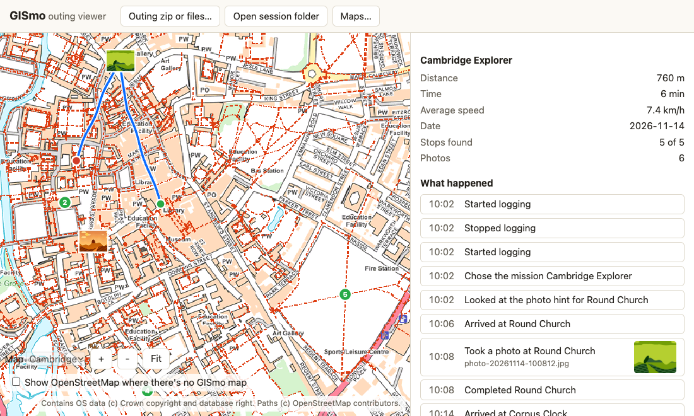

# Outing viewer

The viewer shows a finished walk: the route, the stops, and every photo where it was taken. Use it [online](https://gadgetoid.github.io/gismo/viewer.html) or from `Planner/viewer.html` on the card.

Open one of these with **Outing zip or files…**:

- an outing zip from the card's `Outings` folder. GISmo saves one when a mission is finished, or when **Save outing** is pressed on the outing summary;
- the files from a mission's folder in `Sessions`: its tracks, `events.csv` and photos. In Chrome and Edge, **Open session folder** opens the folder itself.

The side panel shows the distance, time and average speed, how many stops were found, and what happened, in order, with the photos. Click a photo, on the map or in the list, to see it full size.

The viewer opens with the example Cambridge map online. For other areas, add the area's `.gmap` files with **Maps…**. Wherever there's no GISmo map, it shows OpenStreetMap instead; untick **Show OpenStreetMap** to keep it offline. OpenStreetMap needs an internet connection, and may not load when the viewer is opened straight from the card rather than online.
