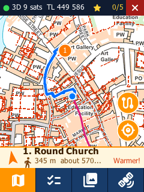
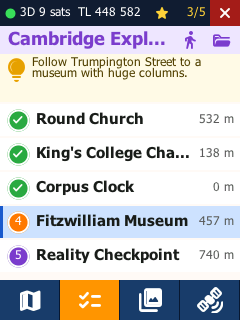
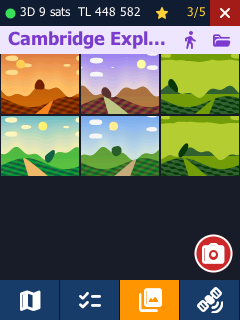
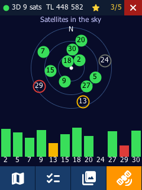
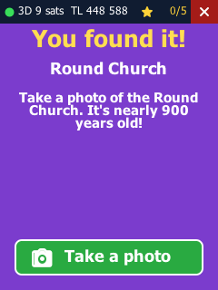
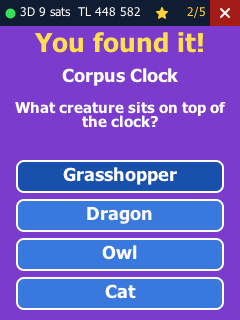
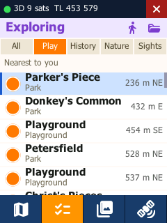
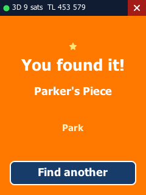
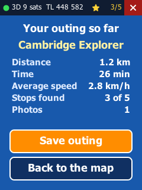
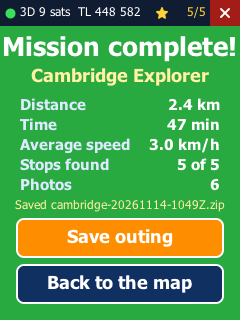

# Using GISmo

## Pages

The two minus buttons above the pad flip between four pages:

- **Map**: you, the next stop and an arrow pointing to it, with the distance in steps and "warmer" or "colder" as you go. Tap the bar at the bottom for the clue. The route button draws a walking route along the paths.
- **Mission**: the stops, with a clue for each. The folder icon chooses a mission (or "Just explore"), and the walking figure shows the outing so far: distance, time, speed, stops found and photos.
- **Photos**: every photo from this mission.
- **Sky**: the satellites the GPS can see.

   

## Stops

Walk to a stop and GISmo shows its task: just getting there, taking a photo, answering a question or counting something. Some stops have a photo hint, opened from the clue.

 

## Exploring

With no mission ("Just explore" in the mission list), the Mission page lists the nearest playgrounds, parks, monuments, viewpoints and other places worth a visit. Left and right switch between kinds of place. Choose one to head there.

 

## Photos

The camera button opens the camera at any time. Turn the Juno on its side, with the rocker and camera button on top: the rocker zooms, up and down on the pad pick a filter, and the camera button takes the photo. Every photo is tagged with where it was taken.

## Outings

When a mission is finished, GISmo saves the outing (the route, the answers and the photos) as a zip in the `Outings` folder on the card. **Save outing** on the outing summary saves one at any time. Open them with the [outing viewer](outing-viewer.md).

 

## Buttons

| Button | Does |
|---|---|
| Rocker, or pad up and down | zoom the map; move through lists and answers |
| Pad left and right | move the map; switch kinds of place when exploring |
| Pad centre, OK | choose; on the map, go back to where you are |
| Minus buttons | previous and next page |
| Camera | open the camera, take a photo; in the camera, the rocker zooms and the pad picks a filter |
| Home | go back to where you are |
| Mail | switch map (modern or old) |
| Windows | up and down move the map too, for a few seconds |
